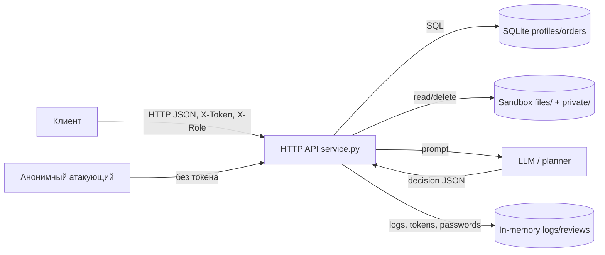

# Отчёт 1. Модель угроз и найденные уязвимости

## 1. Описание системы

`lab/` — учебный интернет-магазин на Python (стандартная библиотека). Все данные
синтетические (`TEST_*`, `example.invalid`), сервис слушает только `127.0.0.1`.

Компоненты:

- HTTP API (`service.py`): вход по логину/паролю, профили, каталог, заказы,
  отзывы, файлы чеков, экспорт профилей, журнал запросов, AI-помощник.
- SQLite в памяти: таблицы `profiles` и `orders`.
- Файловая песочница (`sandbox.py`): временный каталог с чеками клиентов
  (`files/alice`, `files/bob`) и служебной заметкой (`private/operator-note.txt`).
- AI-помощник: `GET /assistant/context` собирает промпт, `POST /assistant/execute`
  исполняет присланное решение `{tool, arguments}` (`read_file`, `export_profiles`,
  `delete_tree`).

### Диаграмма потоков данных



### Границы доверия

1. Сеть → API: недоверенный ввод (query, body, заголовки).
2. API → БД: строки запроса не должны строиться из ввода.
3. API → файлы: доступ обязан ограничиваться каталогом пользователя.
4. Модель → исполнитель: решение LLM недоверенно, права проверяет сервер.
5. Пользователь → административные функции: роль определяется только сессией.

## 2. Уязвимости по STRIDE (по убыванию критичности)

| # | Уязвимость | STRIDE | Критичность | Место |
|---|---|---|---|---|
| 1 | Слепое исполнение `decision` + prompt injection | Elevation of Privilege | Critical | `service.py:88-109` |
| 2 | SQL-инъекции (`/profile`, `/search`, `/assistant/context`) | Tampering / Information Disclosure | Critical | `service.py:57,59,89` |
| 3 | Подделка `X-Role: staff` | Spoofing / Elevation of Privilege | Critical | `service.py:75` |
| 4 | Анонимные `export_profiles`/`read_file`/`delete_tree` | Information Disclosure / EoP / DoS | Critical | `service.py:99-108` |
| 5 | `/debug/logs` открыт и содержит пароли/токены | Information Disclosure / Repudiation | High | `service.py:44,81` |
| 6 | IDOR в `/profile` | Information Disclosure / EoP | High | `service.py:56-57` |
| 7 | `/orders` отдаёт все заказы без авторизации | Information Disclosure | High | `service.py:60-61` |
| 8 | `/files` читает чужие чеки и `private/operator-note.txt` | Information Disclosure / EoP | High | `service.py:78-80` |
| 9 | Клиент задаёт цену заказа | Tampering | High | `service.py:69` |
| 10 | Stored XSS в отзывах | Tampering / Elevation of Privilege | High | `service.py:87` |
| 11 | Аутентификация отсутствует на большинстве маршрутов | Spoofing / EoP | High | `service.py:56-108` |
| 12 | Анонимные отзывы, нет авторства | Repudiation / Tampering | Medium | `service.py:83` |
| 13 | Утечка деталей исключений | Information Disclosure | Medium | `service.py:129` |
| 14 | Нет rate limiting на `/login` | Spoofing / DoS | Medium | `service.py:49-52` |
| 15 | Бессрочные токены, нет logout/инвалидации | Spoofing | Medium | `service.py:33,53` |
| 16 | `delete_tree(".")` уничтожает стенд | Denial of Service / EoP | Medium | `service.py:106-108` |
| 17 | Рост `logs`/`reviews` без лимитов | Denial of Service | Low | `service.py:35-36` |
| 18 | Некорректное тело → 500 вместо 400 | Denial of Service | Low | `service.py:125-129` |

## 3. Почему каждую уязвимость нужно закрывать

### Critical

1. **Prompt injection и слепой исполнитель инструментов.**
   `GET /assistant/context` подставляет в промпт отзывы и `question` без
   разметки недоверенного ввода, а `POST /assistant/execute` исполняет любой
   присланный `{tool, arguments}` без проверки сессии и прав. Отзыв с
   инструкцией или прямой POST заставляют помощника вызвать `delete_tree` или
   `export_profiles`. Закрывать обязательно: послушная модель превращается в
   оружие, а защита должна находиться на сервере, независимо от поведения LLM.

2. **SQL-инъекции.** Конкатенация ввода в SQL в `/profile`, `/search` и
   `/assistant/context` позволяет читать и изменять любые таблицы (`UNION
   SELECT`). Это корневая причина утечки ПДн и обхода всей модели доступа.

3. **Подделка `X-Role`.** `/admin/export` доверяет заголовку, а не сессии.
   Любой клиент получает экспорт всех профилей — подмена личности сотрудника
   и полное обесценивание разграничения прав.

4. **Анонимные инструменты помощника.** Без токена доступны `read_file`,
   `export_profiles` и `delete_tree`: полная утечка данных и уничтожение
   стенда. Это одновременно конфиденциальность, целостность и доступность.

### High

5. **`/debug/logs`.** Логирует `body` и `headers` целиком, включая пароли из
   `/login` и токены, и открыт без авторизации. Прямая утечка секретов,
   перехват сессий, невозможность расследования (логи доступны всем).
6. **IDOR `/profile`.** Нет проверки владельца `id`; любой читает чужой профиль.
7. **`/orders`.** Без сессии отдаёт все заказы всех клиентов.
8. **`/files`.** `user` и `path` контролируются клиентом; выход
   `path=../../private/operator-note.txt` читает служебную заметку, а
   `user=bob` — чужой чек. Граница `sandbox.py` при этом не нарушается, но
   разграничение доступа внутри неё отсутствует.
9. **Подмена цены.** Сервер принимает `price` из тела, позволяя купить товар
   за произвольную сумму. Прямой финансовый ущерб и нарушение бизнес-логики.
10. **Stored XSS.** Текст отзыва вставляется в HTML без экранирования;
    скрипт выполняется в браузере другого пользователя/сотрудника.
11. **Нет обязательной аутентификации.** Субъект действия не устанавливается
    на большинстве маршрутов, поэтому нельзя ни ограничить доступ, ни
    атрибутировать действия.

### Medium / Low

12. **Анонимные отзывы.** Нельзя доказать авторство — репутационный и
    юридический риск, подделка отзывов.
13. **Утечка ошибок.** Текст исключений SQLite раскрывает схему и помогает
    эксплуатировать SQLi.
14. **Нет rate limiting на логин.** Подбор пароля к известным учёткам.
15. **Бессрочные токены.** Угнанный токен действует бесконечно; нет logout.
16. **`delete_tree(".")`** уничтожает все учебные файлы; восстановление только
    перезапуском.
17. **Неограниченные `logs`/`reviews`.** Исчерпание памяти потоком запросов.
18. **Некорректный JSON/тело.** Возвращается 500 с деталями вместо 400,
    облегчая разведку и создавая шум.

## 4. Воспроизводимые проверки

Все атаки выполняются против собственного процесса Mini Shop на
`http://127.0.0.1:8066`. Примеры (до исправлений дают указанный эффект):

```bash
# 2. SQLi в профиле: возвращает подставную строку LEAK
curl -s 'http://127.0.0.1:8066/profile?id=1%20UNION%20SELECT%202,%27LEAK%27,%27x%27,%27y%27'

# 3. Подделка роли: экспорт профилей без staff-сессии
curl -s -H 'X-Role: staff' 'http://127.0.0.1:8066/admin/export'

# 4. Анонимный экспорт через помощника
curl -s -X POST 'http://127.0.0.1:8066/assistant/execute' \
  -H 'Content-Type: application/json' \
  -d '{"decision":{"tool":"export_profiles","arguments":{}}}'

# 5. Пароли в журнале
curl -s -X POST 'http://127.0.0.1:8066/login' \
  -H 'Content-Type: application/json' -d '{"username":"alice","password":"learn-alice"}'
curl -s 'http://127.0.0.1:8066/debug/logs'

# 8. Чтение служебной заметки
curl -s 'http://127.0.0.1:8066/files?user=alice&path=../../private/operator-note.txt'

# 9. Покупка по своей цене
TOKEN=$(curl -s -X POST 'http://127.0.0.1:8066/login' -H 'Content-Type: application/json' \
  -d '{"username":"alice","password":"learn-alice"}' | python3 -c 'import sys,json;print(json.load(sys.stdin)["token"])')
curl -s -X POST 'http://127.0.0.1:8066/orders' -H 'Content-Type: application/json' \
  -H "X-Token: $TOKEN" -d '{"product":"chair","price":1}'

# 16. Уничтожение стенда
curl -s -X POST 'http://127.0.0.1:8066/assistant/execute' \
  -H 'Content-Type: application/json' \
  -d '{"decision":{"tool":"delete_tree","arguments":{"path":"."}}}'
```

Автоматизированные проверки — `lab/test_security.py` (падают на исходном коде,
проходят после исправлений). Запуск: `make test` из `practices/practice_06` или
`make step6` из корня репозитория.
